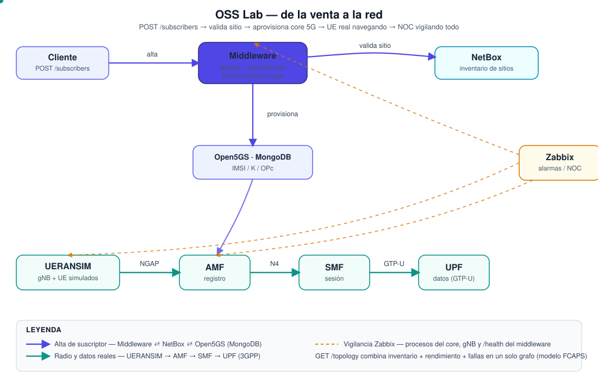

# OSS Lab — 5G core, inventory and monitoring

**OSS and network** lab (no BSS): a custom middleware turns a sign-up into an active subscriber in the
5G core, validating the coverage site in the inventory and getting watched over by the NOC.

> This folder is the **public version** of the lab: same code and same architecture, with no data from
> any concrete instance (IPs, SSH keys, panel passwords). See
> [`docs/ESTADO-DEMO.md`](docs/ESTADO-DEMO.md) for what's actually tested and what's deliberately left out.

## Architecture and data flow



```
POST /subscribers ──▶ middleware (NestJS) ──▶ validates site ──▶ NetBox (inventory)
                                   │
                                   └────────▶ generates IMSI/K/OPc ──▶ Open5GS MongoDB (5G core)

Zabbix ──▶ watches core/gNB processes and GET /health on the middleware
```

See what each system does and how they relate in [`docs/ARQUITECTURA.md`](docs/ARQUITECTURA.md).

The only part that's custom-built is the **middleware** (`middleware/`); everything else is open
source software that's only installed and configured (`infra/`).

## Repo structure

```
oss-lab/
├── middleware/     # NestJS provisioning service (the only "custom" piece)
├── infra/          # Infrastructure as code: VM bootstrap, NetBox, Zabbix, Open5GS/UERANSIM
├── scripts/        # Operational scripts (deploying the middleware to a remote instance)
└── docs/           # Architecture, diagram, and demo status
```

## Software used

| Software | Role | Repository |
| --- | --- | --- |
| Open5GS | 4G/5G core | [open5gs/open5gs](https://github.com/open5gs/open5gs) |
| UERANSIM | Simulated gNB and UE | [aligungr/UERANSIM](https://github.com/aligungr/UERANSIM) |
| NetBox | Site inventory | [netbox-community/netbox-docker](https://github.com/netbox-community/netbox-docker) |
| Zabbix | Alarms and KPIs | [zabbix/zabbix-docker](https://github.com/zabbix/zabbix-docker) |

## Quickstart

### 1. Set up your own VM

```bash
scp -i <your-key> infra/bootstrap/bootstrap-vm.sh ubuntu@<ip>:~
ssh -i <your-key> ubuntu@<ip> "bash bootstrap-vm.sh"
```

Then follow, in order: [`infra/open5gs/README.md`](./infra/open5gs/README.md),
[`infra/ueransim/README.md`](./infra/ueransim/README.md), [`infra/netbox/README.md`](./infra/netbox/README.md),
[`infra/zabbix/README.md`](./infra/zabbix/README.md).

### 2. Develop the middleware locally

```bash
cd middleware
cp .env.example .env   # fill in real NETBOX_URL/TOKEN and OPEN5GS_MONGO_URI
npm install --legacy-peer-deps
npm run start:dev
```

### 3. Deploy it to your instance

```bash
SSH_KEY=~/.ssh/your-key.key REMOTE=ubuntu@<your-vm-ip> ./scripts/deploy-middleware.sh
```

The script syncs `middleware/` via rsync and brings up the container with `docker compose`. The
server's `.env` is **never touched** by the script — it's created once by hand on the server with the
real secrets.

## Security

- Admin ports (9999, 8000, 8080, 27017) should only be opened to specific IPs, never to
  `0.0.0.0/0` — these are panels with default credentials.
- K/OPc are never written to logs (`middleware/src/subscribers/subscribers.service.ts`).
- No `.env`, SSH key, or real credential is included in this repo — only `*.example.*` files with
  placeholders.

## Roadmap (out of scope for this repo for now)

- Expose the sign-up through the **TMF640** API (TM Forum Open APIs) on the same endpoint.
- Phase 2 (BSS: Kill Bill or Odoo) would call this same `POST /subscribers` — it would be treated as a
  **separate project**; this repo stays OSS-only.
- Phase 2 (optional, within OSS): **NF multi-tenancy**. Today `/topology` assumes a single Open5GS
  core (one fixed AMF/SMF/UPF) and a single simulated gNB — NetBox sites are inventory only, not tied
  to any NF or customer.

## License

MIT — see [`LICENSE`](LICENSE).
